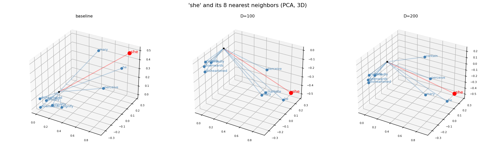

# Word2Vec From Scratch

A Python/NumPy implementation of the skip-gram Word2Vec model with negative sampling, created for CS 585 Programming Assignment 02. The project trains word embeddings from a text corpus, finds words with similar embeddings, and includes experiments comparing training settings.

## Requirements

- Python 3
- NumPy
- scikit-learn
- Matplotlib

Install the packages with:

```bash
python -m pip install numpy scikit-learn matplotlib
```

Run the examples from the project directory. Parts A and B expect their input and output files there; `experiments.py` reads the corpus and writes its `experiments/` folder relative to the current working directory.

## Train Embeddings

The included `CORPUS_FILE.txt` can be used to train embeddings:

```bash
python CS585_P02A_A20597307.py 50 CORPUS_FILE.txt
```

The first argument is the embedding dimension (`D`); the second is the corpus filename. `D` must be a positive integer. If it is invalid, the script uses the default dimension of 50. The corpus is lowercased, characters other than ASCII letters are treated as word separators, and tokens are used to build the vocabulary and training pairs.

Training settings are defined in `CS585_P02A_A20597307.py`:

| Setting | Default |
|---|---:|
| Embedding dimensions | 50 |
| Context window radius | 2 |
| Learning rate | 0.025 |
| Epochs | 5 |
| Negative samples per pair | 2 |

The script writes `CS585_P02A_A20597307_EMBED.TXT` in the project directory, replacing any existing file with that name. Each line contains a vocabulary word followed by its comma-separated embedding values.

## Find Nearest Neighbors

After training, query a word and choose how many neighbors to show:

```bash
python CS585_P02B_A20597307.py woman 5
```

The word must be in the generated embedding vocabulary and contain only Latin letters. The script lowercases the query, ranks other words by cosine similarity, and opens a 3D PCA plot of the query and its neighbors. `K` must be from 1 to 10; otherwise, the script uses 5. The embedding file must be present in the project directory.

## Run Experiments

Run the experiment script with a corpus filename:

```bash
python experiments.py CORPUS_FILE.txt
```

It compares embedding dimensions 50, 100, and 200, as well as changes to learning rate, epoch count, negative-sample count, and context window. Test words and related word pairs are configured near the top of `experiments.py`. Outputs are written to `experiments/`:

- `summary.md` contains training metrics, cosine similarities, and nearest-neighbor comparisons.
- `D_<word>.png` compares the embedding dimensions.
- `GD_<word>.png` compares gradient-descent and context-window settings.

### Example: Dimensionality Comparison

This figure compares the eight nearest neighbors of `she` for embedding dimensions 50, 100, and 200. Neighbors are selected by cosine similarity; PCA projects the vectors to three dimensions for visualization.



## Project Files

- `CS585_P02A_A20597307.py`: preprocessing, vocabulary construction, skip-gram training, and embedding output.
- `CS585_P02B_A20597307.py`: cosine-similarity search and 3D PCA visualization.
- `experiments.py`: configurable training comparisons and report generation.
- `CORPUS_FILE.txt`: sample training corpus.
- `CS585_P02A_A20597307_EMBED.TXT`: generated embedding data used by Part B.
- `experiments/summary.md`: recorded experiment results.
